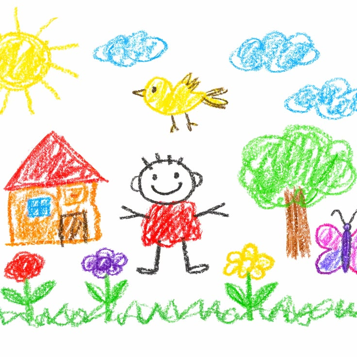
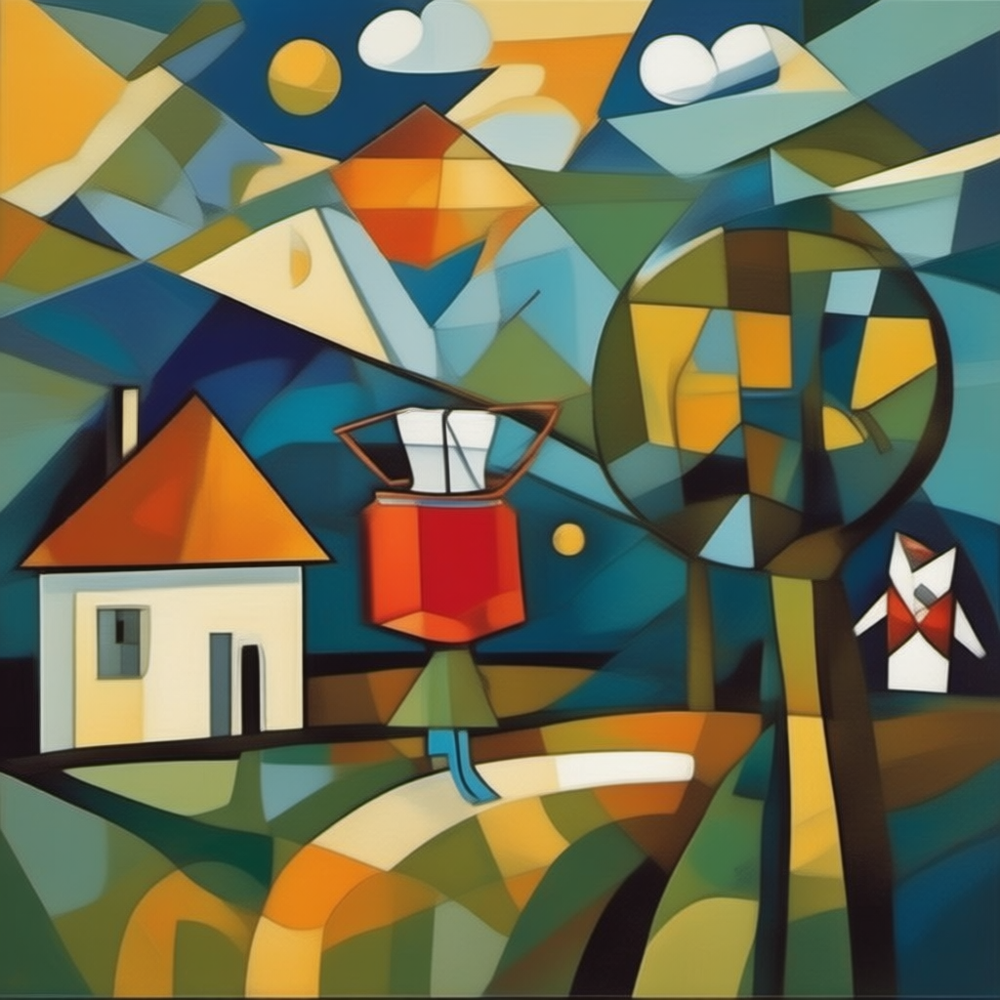
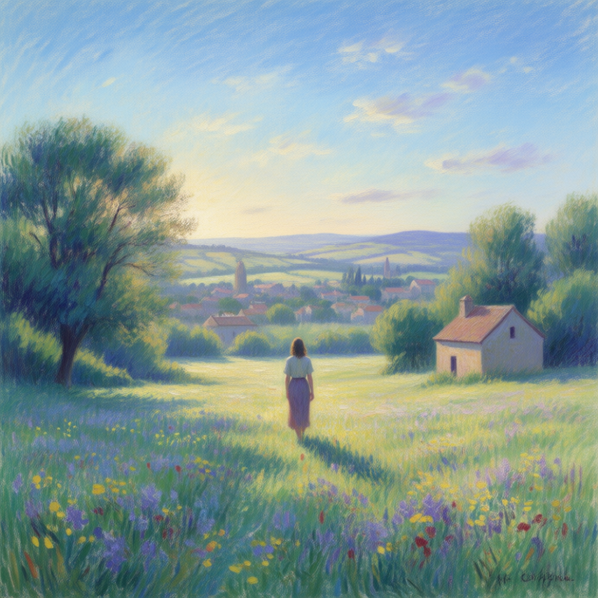
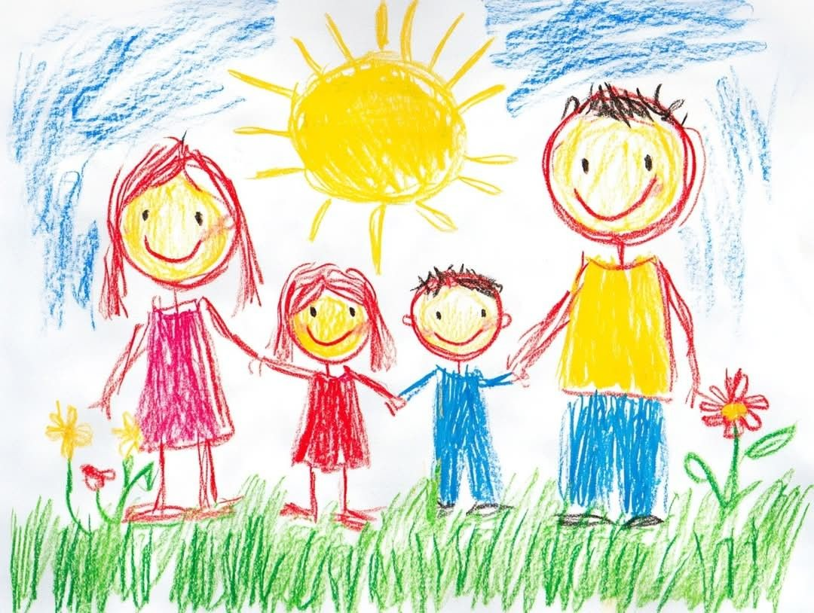
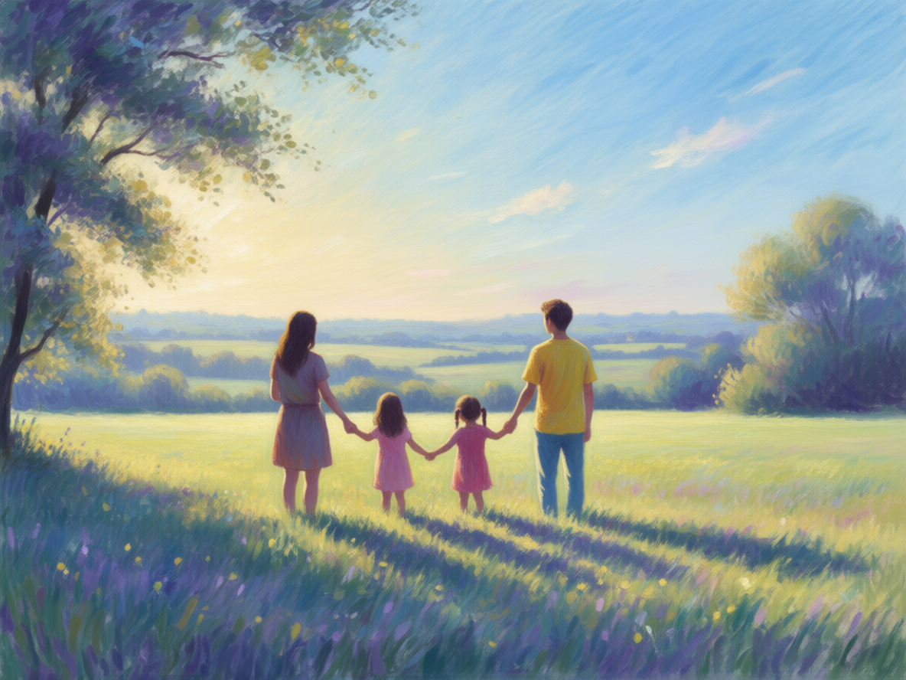
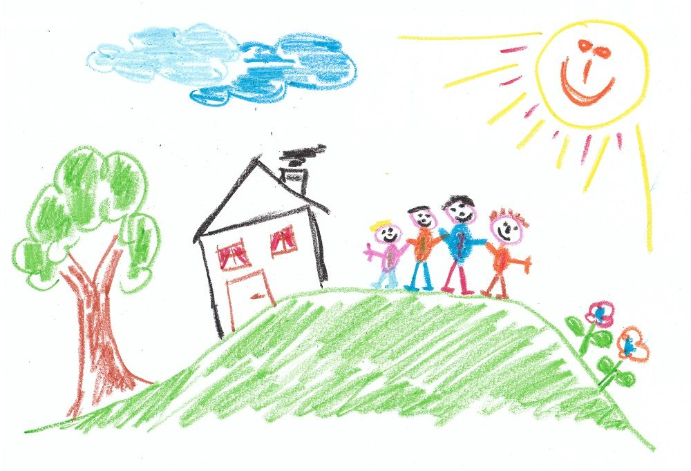
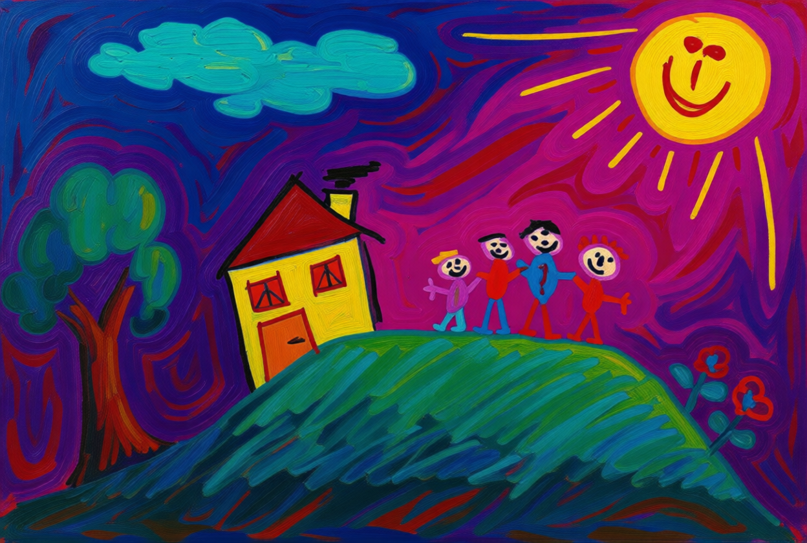
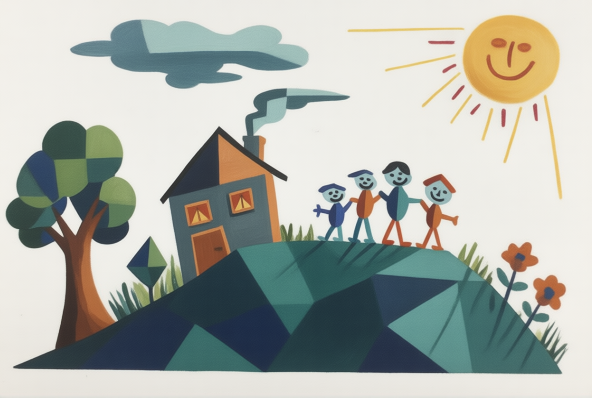
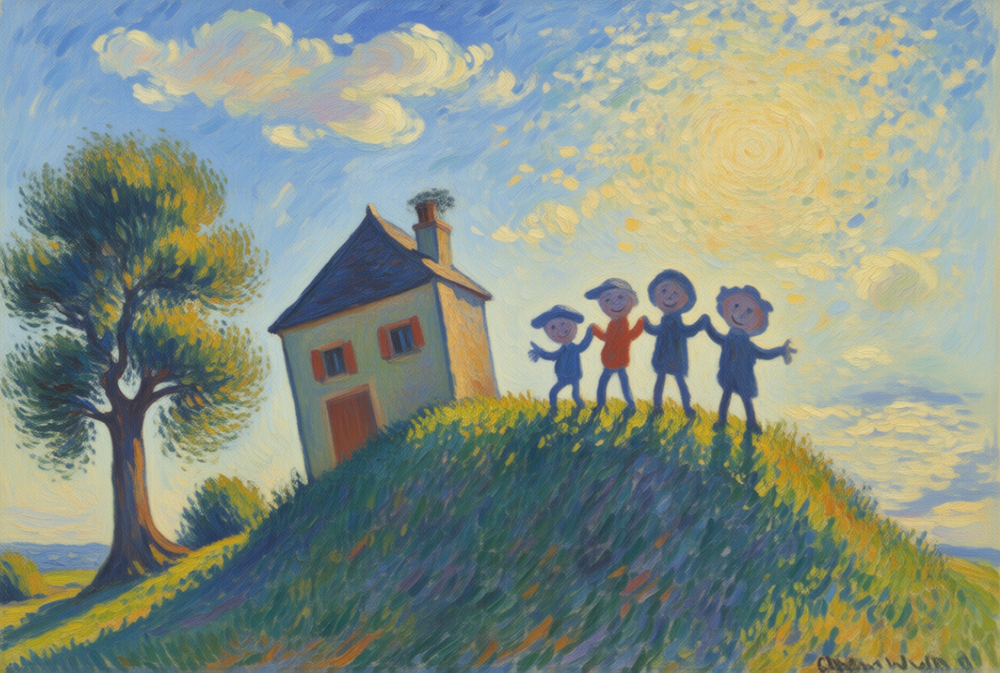

# 开发样例与复现配方

本页收录三张原画与九张当前展示结果。图片不属于独立验收集，也不代表已完成真实儿童研究。所有样例的自动确认状态均为空；用户认可只针对指定图片。

[本地 HTML 画廊](gallery.html) · [完整参数与哈希](manifest.json) · [项目说明](../MVP_V1.0.md)

## 对照

| 原画 | 野兽派 · 开发候选 | 立体主义 · 用户认可 | 印象派 |
|---|---|---|---|
| 花园<br> | <br>开发候选 · 未验收 | <br>用户认可 · 保留 | <br>新候选 · 待评价 |
| 一家四口<br> | <br>开发候选 · 未验收 | <br>用户认可 · 保留 | <br>新候选 · 待评价 |
| 山坡与房屋<br> | <br>开发候选 · 未验收 | <br>用户认可 · 保留 | <br>用户认可 · 视觉参照 |

## 当前限制

- 野兽派为开发样例；尚未证明在新输入上有稳定的画派表现。
- 立体主义三张与山坡印象派获用户认可；不等于系统自动确认或独立质量验收。
- 两张新印象派共用同一份中文摘要，以环境、光照与空间为重点；人物变为背影，笔触比山坡参照细软，仍待用户评价。
- 花园部分小元素省略，山坡参照保留右下角疑似伪签名；样例页不把这些限制隐藏为已解决。
- 当前展示采用多种独立配方。野兽派样例的实际 Prompt 仍保留更强的内容约束；它是该图的复现记录，不替代全局“风格优先、主题关联”规则。

## 复现一张新印象派候选

完成 [本地部署](../docs/DEPLOYMENT.md) 后，在仓库根目录的 PowerShell 中执行：

```powershell
$artPrompt = Get-Content -Raw -Encoding UTF8 examples/prompts/01_garden_impressionism.txt
.\.venv\Scripts\python.exe -m tools.bench_generate `
  --photo samples/children_originals/01_garden.png --artwork --style impressionism `
  --config examples/recipes/01_garden_impressionism.json `
  --prompt $artPrompt --seed 81401 --out runs/bench
```

这会调用本地模型，只生成候选与参数记录，不调用自动检查器或生成已确认的 `output.png`。其他图使用 manifest 中对应的输入、配方、Prompt 和种子。每个配方包含实际采样、预处理、负面提示和模型侧尺寸；图像、正面 Prompt 与实际参数均已单独保存。

| 配方组 | 参数 | 状态 |
|---|---|---|
| 应用默认（`configs/app.json`） | 4 步、CFG 1、Lightning | 正常自动流程基线 |
| 三张野兽派示例 | 4 步、CFG 1.5、Lightning | 开发候选 |
| 立体主义与印象派示例 | 20 步、CFG 4、无 LoRA | 具体状态见图 |

所有样例使用 Euler/simple、shift 3、denoise 1。样例工作流不做模型侧中心裁切；应用默认工作流与样例不同。已保存图片是生成时的结果，不保证不同服务版本、硬件或缓存状态下逐像素一致。

原画只作为图像条件；复现不需要加入逐图对象描述。生成前请核对本机模型文件名与配置一致。
