# 八画派开发样例与复现

三张用户提供的原画、八种画派、二十四张选定结果。五种新增画派各三张，共十五张新候选，生成于 2026 年 10 月 19 日。原画都已用于调参，不是独立验收集；没有儿童参与者测试结果。

- [完整 HTML 对照页](gallery.html)：每种画派分别并排展示原画与结果，含实际 Prompt、参数及状态。克隆后在浏览器打开；GitHub 文件页显示源码。
- [参数与哈希清单](manifest.json)：全部二十四张结果的模型、种子、采样、耗时、图片和配方路径。
- [实验画派注册表](styles.json) · [项目说明](../MVP_V1.0.md)

下图为一家四口原画与五种新增方向的预览；完整八画派结果见下表及对照页。

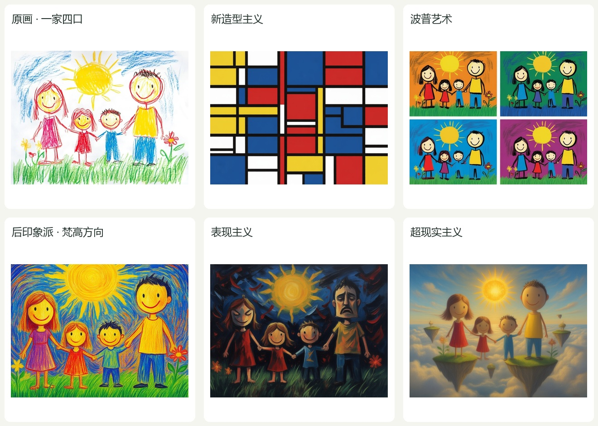

## 原始输入

| 花园 | 一家四口 | 山坡与房屋 |
|---|---|---|
|  |  |  |

## 选定结果

| 画派 | 花园 | 一家四口 | 山坡与房屋 |
|---|---|---|---|
| 野兽派 · 既有开发候选 |  |  |  |
| 立体主义 · 用户认可保留 |  |  |  |
| 印象派 · 前两张待评价，山坡为认可参照 |  |  |  |
| 后印象派（梵高方向）· 新候选 | 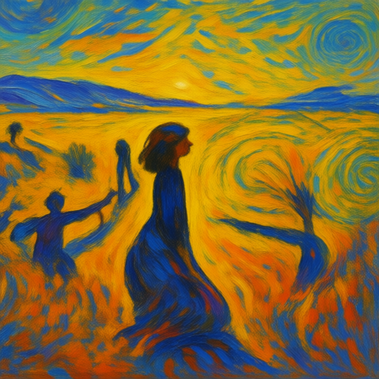 |  | 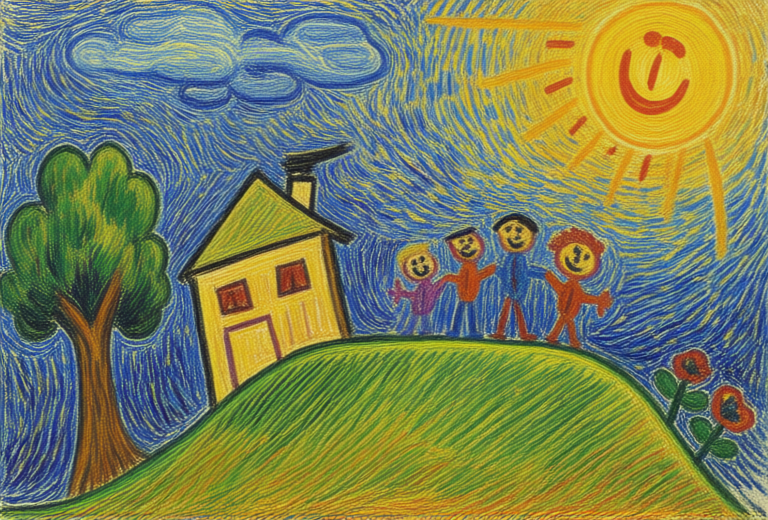 |
| 表现主义 · 新候选 | 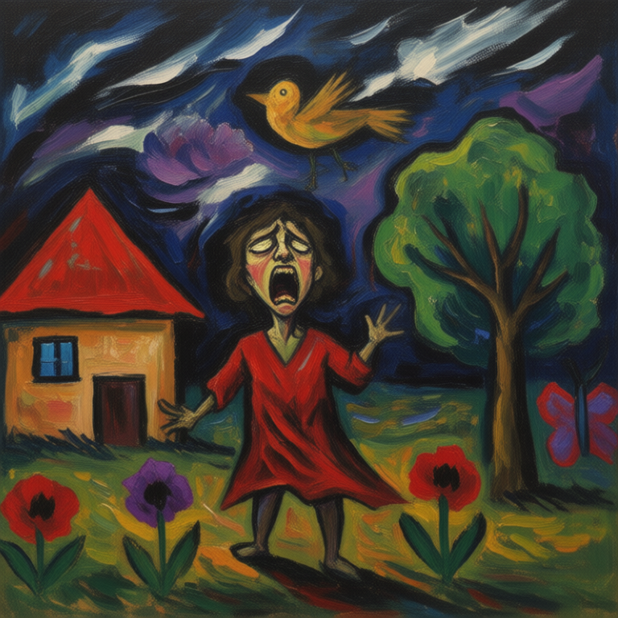 | 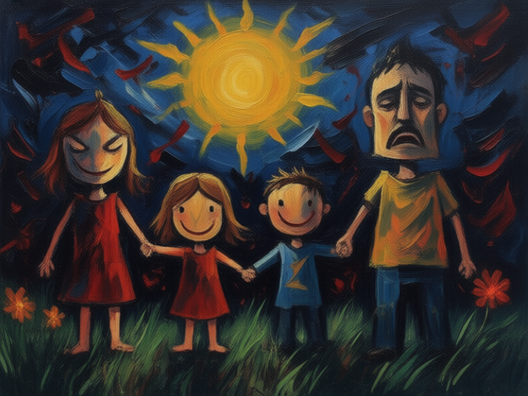 | 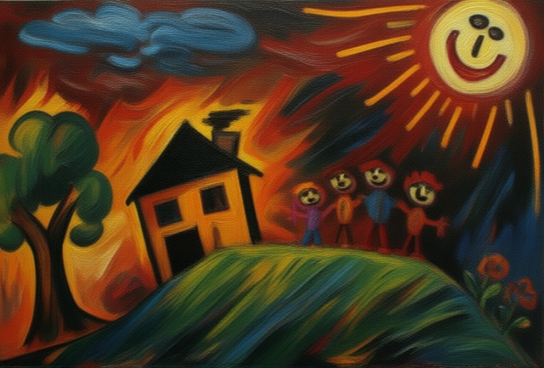 |
| 超现实主义 · 新候选 | 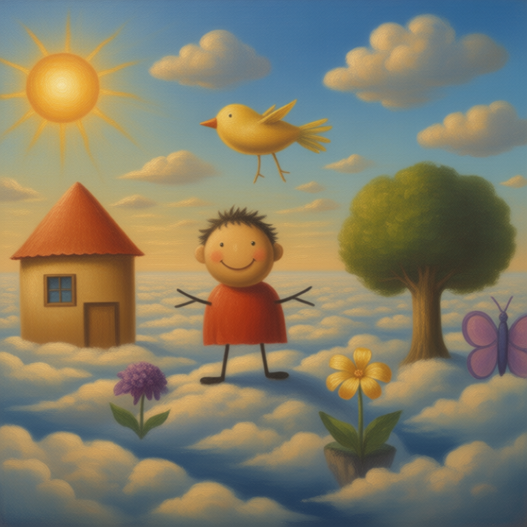 |  |  |
| 新造型主义 · 新候选 | 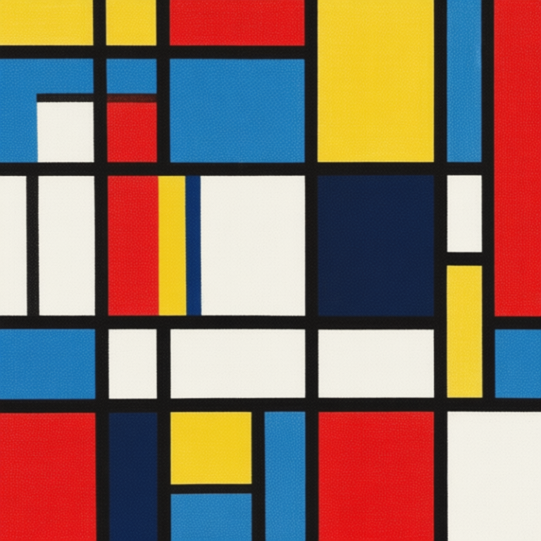 | 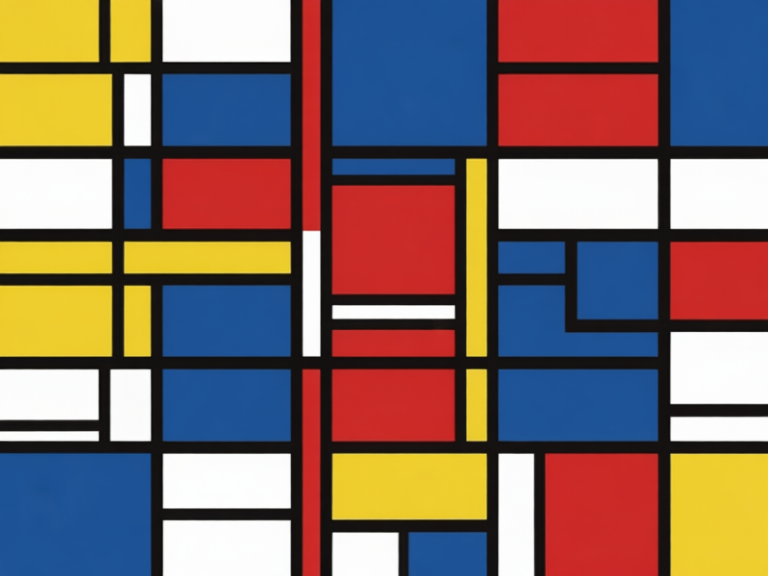 | 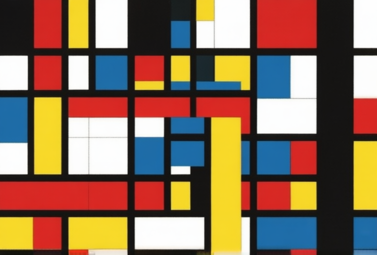 |
| 波普艺术 · 新候选 | 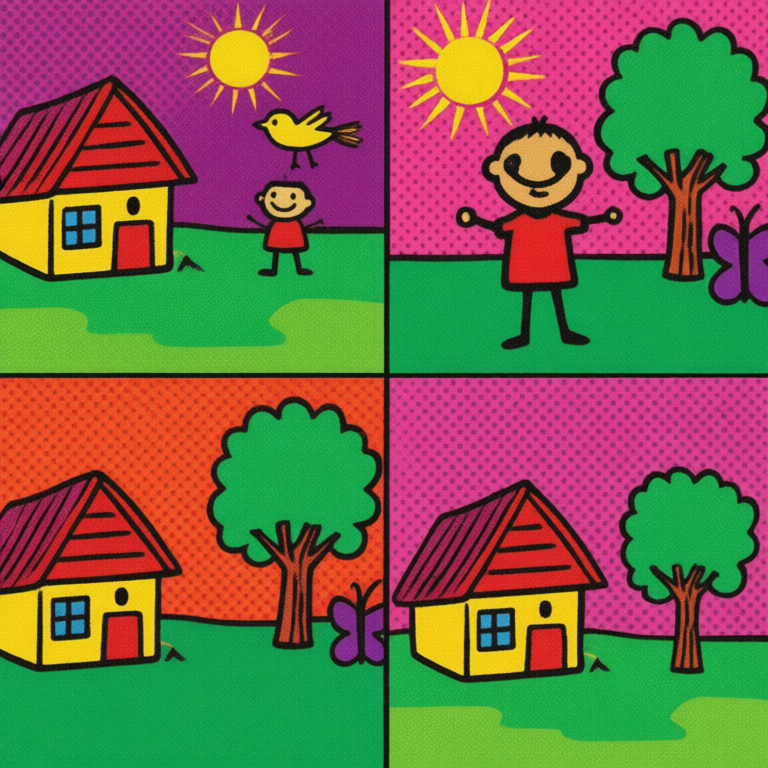 | 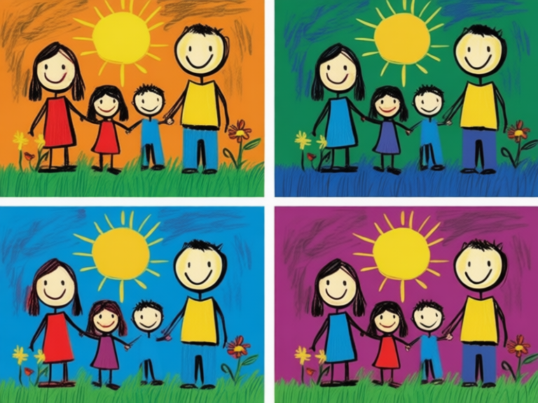 | 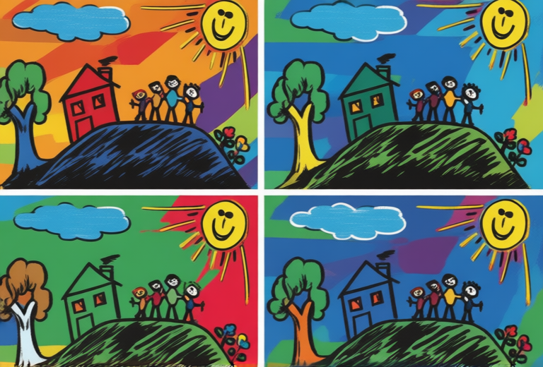 |

三张立体主义及山坡印象派保留原始 PNG、Prompt 和参数。野兽派仍为开发样例；花园与家庭印象派仍待评价，人物改为背影，笔触较山坡参照细软。山坡印象派右下角已有疑似伪签名，未修图或替换。

## 新增方向与待评价问题

| 画派 | 当前选择 | 共用 Prompt | 可见限制 |
|---|---|---|---|
| 后印象派 | 梵高式方向：有方向的短笔触、形体节奏、黄橙与蓝紫对比 | [查看](prompts/01_garden_post_impressionism.txt) | 不代表整个后印象派；花园场景重组，家庭与山坡仍有儿童画轮廓 |
| 表现主义 | 扭曲形体、倾斜空间、粗重轮廓和情绪性笔触 | [查看](prompts/01_garden_expressionism.txt) | 本组偏焦虑和紧张，花园人物呈惊叫表情，山坡有火焰状笔触 |
| 超现实主义 | 明亮云海、悬浮岛屿、尺度错位与不可能空间 | [查看](prompts/01_garden_surrealism.txt) | 造型偏圆润童话感，人物数量和位置可变化 |
| 新造型主义 | 水平垂直结构、红黄蓝与黑白、非对称平衡 | [查看](prompts/01_garden_neoplasticism.txt) | 具象内容高度抽象，是否保留足够主题联系尚不明确 |
| 波普艺术 | 四联图像重复、专色、粗轮廓和印刷质感 | [查看](prompts/01_garden_pop_art.txt) | 部分结果仍保留粗糙手绘线条与原画符号 |

每种新增画派跨三张原画严格共用正负 Prompt。原图为唯一图像条件，不先生成逐图 caption，不输入其他画作作参考。五种新增画派的十五张结果均待用户评价，没有自动粗检通过记录，也未完成独立质量验收；未作为已确认的 `output.png` 发布。

## 配方

| 用途 | steps / CFG | LoRA | 输出尺寸 |
|---|---|---|---|
| 应用默认三画派 | 4 / 1 | Lightning，强度 1 | 由生产工作流决定 |
| 野兽派展示 | 4 / 1.5 | Lightning，强度 1 | 见单图清单 |
| 立体主义、印象派展示 | 20 / 4 | 无 | 见单图清单 |
| 本次新增五种画派 | 20 / 4 | 无 | 长边 768 px |

展示均使用 Qwen-Image-Edit-2509-Q3_K_M.gguf、Qwen2.5-VL-7B-Instruct-Q4_K_M.gguf 与 qwen_image_vae.safetensors；Euler / simple、shift 3、denoise 1。完整画作关闭画框检测、前处理裁边及模型侧裁切。记录的耗时包含上传、排队、等待和下载，不是纯采样速度。

八画派注册表 `examples/styles.json` 仅供独立展示配方使用，Prompt 版本为 `extended-1.0`。生产仍使用 `configs/styles.json` 的三个画派及原有配置、Prompt 和检查器；候选不会自动加入正式随机池。

## 本地复现

在仓库根目录执行，先按 [部署说明](../docs/DEPLOYMENT.md) 准备 Python 环境、权重与本地 ComfyUI。以下命令只生成一张独立候选，不调用自动检查或确认，也不覆盖仓库选图。

```powershell
$example = (Get-Content -Raw -Encoding UTF8 examples/manifest.json | ConvertFrom-Json).results |
    Where-Object { $_.id -eq '01_garden_post_impressionism' }
$artPrompt = Get-Content -Raw -Encoding UTF8 $example.prompt_file
.\.venv\Scripts\python.exe -m tools.bench_generate `
    --photo $example.original --artwork --style $example.style `
    --config $example.config --prompt $artPrompt --seed $example.seed `
    --out runs/bench
```

替换 `id` 可复现其他选图。逐件串行运行，服务错误时停止。种子与配方不保证不同硬件、服务或缓存状态下逐像素一致。

新增配方仅将路径改为仓库相对路径，并固定生成时实际使用的预处理与无 LoRA 设置。`config_sha256`、`workflow_sha256` 对应公开文件；`source_generation_*_sha256` 记录原始生成文件的哈希。图片按原始字节复制。

只重建 HTML 对照页（不调用模型）：

```powershell
.\.venv\Scripts\python.exe examples/build_gallery.py
```
